

# راهنمای کاربر DAS Tools

افزونهٔ رایگان اتوکد برای نقشه‌برداران. نسخهٔ `10.7.3`.

## فهرست

1. [DAS Tools چیست](#intro)
2. [پیش‌نیازها و نصب](#install)
3. [شروع سریع](#quick)
4. [دستورهای DAS و DASL](#das)
5. [پنجرهٔ تنظیمات](#dialog)
6. [پنجرهٔ انگلیسی](#dialog_en)
7. [رأس شمارهٔ ۱](#start)
8. [مجاورین](#nb)
9. [خروجی روی نقشه](#output)
10. [خروجی اکسل و گواهی](#excel)
11. [کنترل کیفیت](#qc)
12. [ویرایش قطعه بعد از خروجی](#update)
13. [دستورهای دیگر](#other)
14. [پرسش‌های رایج](#faq)
15. [فهرست دستورها](#ref)
16. [حمایت از DAS Tools](#support)

## ۱. DAS Tools چیست

DAS Tools یک افزونهٔ رایگان AutoLISP برای اتوکد است. پلی‌لاین مرز قطعه را می‌گیرد و در چند ثانیه همهٔ آنچه یک نقشهٔ تعیین مختصات لازم دارد روی نقشه می‌گذارد: شمارهٔ رئوس، طول اضلاع، مجاورین، برچسب مساحت و جدول مختصات UTM. از همان قطعه دو فایل اکسل هم می‌سازد که یکی برگهٔ «گواهی تعیین مختصات ملک» برای پروندهٔ ثبتی است.

کاری که با دست برای هر قطعه حدود نیم ساعت طول می‌کشد، با DAS به یک انتخاب و یک پنجرهٔ تنظیمات کوتاه می‌شود. چون همه‌چیز از روی خود پلی‌لاین حساب می‌شود، اشتباه رونویسی مختصات و طول هم پیش نمی‌آید.

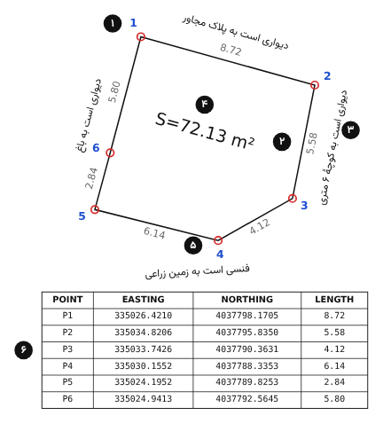 <b>شکل ۱.</b> خروجی DASL روی یک قطعهٔ نمونه. ۱: شمارهٔ رأس، ۲: طول ضلع، ۳: متن مجاور، ۴: برچسب مساحت، ۵: مارکر رأس، ۶: جدول مختصات.

این راهنما برای نسخهٔ `10.7.3` نوشته شده است. شکل‌ها نمونه‌اند و ممکن است با ظاهر اتوکد شما کمی فرق داشته باشند.

## ۲. پیش‌نیازها و نصب

### پیش‌نیازها

**اتوکد کامل.** DAS روی AutoCAD نوشته و آزموده شده است. نسخهٔ LT از توابع ActiveX که DAS برای مساحت زنده، ابعاد و اکسل به آن‌ها نیاز دارد پشتیبانی نمی‌کند.

**Microsoft Excel** فقط برای صدور گواهی لازم است. بقیهٔ کارها بدون اکسل هم انجام می‌شود.

**نقشه در دستگاه UTM.** مختصات قطعه باید متری و در زون‌های ایران (۳۸ تا ۴۱) باشد. اگر نقشه در دستگاه محلی یا جغرافیایی است، DAS هشدار می‌دهد.

### فایل‌ها

بستهٔ دانلود یک فایل زیپ است با پوشهٔ `DAS-Tools`. پوشه را جایی ثابت بگذارید، مثلاً `C:\DAS-Tools`. فایل `DAS.lsp` و پوشهٔ `templates` باید کنار هم بمانند، چون DAS الگوهای اکسل را در همین پوشه جست‌وجو می‌کند.

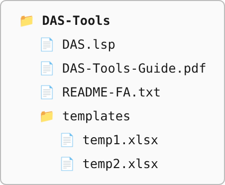 <b>شکل ۲.</b> محتوای بستهٔ دانلود. پوشهٔ templates باید کنار فایل لیسپ بماند.

### بارگذاری

۱. در اتوکد دستور `APPLOAD` را بزنید، فایل `DAS.lsp` را انتخاب کنید و روی Load بزنید. در خط فرمان پیام `DAS Tools V10.7.3 loaded` و فهرست دستورها چاپ می‌شود.

۲. برای اینکه در هر بار باز کردن اتوکد خودکار بارگذاری شود، در همان پنجره روی Contents در بخش Startup Suite بزنید و فایل را اضافه کنید.

۳. اگر اتوکد پیام امنیتی داد، Always Load را بزنید، یا پوشه را در `OPTIONS`، زبانهٔ Files، بخش Trusted Locations اضافه کنید.

۴. پوشه را در همان زبانه به Support File Search Path هم اضافه کنید. این کار اختیاری است، ولی بدون آن DAS بار اول صدور اکسل محل `temp1.xlsx` را از شما می‌پرسد.

### به‌روزرسانی

نام فایل در همهٔ نسخه‌ها `DAS.lsp` است. برای نسخهٔ تازه، فایل‌های بستهٔ جدید را روی همان پوشه کپی کنید. مسیر Startup Suite عوض نمی‌شود و تنظیمات و اطلاعاتی که روی قطعه‌ها ذخیره شده دست نمی‌خورد. نسخه‌ای که بارگذاری شده در پیام بارگذاری و عنوان پنجرهٔ DAS دیده می‌شود.

> **نکته:** اگر نسخهٔ قدیمی‌تری با نام دیگر، مثل `Das_10.4.lsp`، در Startup Suite دارید، آن را حذف کنید تا دو نسخه با هم بارگذاری نشوند.

## ۳. شروع سریع

برای اولین بار این پنج گام کافی است:

۱. مرز قطعه را با یک پلی‌لاین بسته بکشید یا پلی‌لاین موجود را آماده کنید.

۲. دستور `DASL` را بزنید. اگر جدول طول اضلاع را نمی‌خواهید، `DAS` را بزنید.

۳. پلی‌لاین را انتخاب کنید. پنجرهٔ تنظیمات به فارسی باز می‌شود. اگر انگلیسی می‌خواهید، دکمهٔ English پایین پنجره را بزنید.

۴. در پنجرهٔ تنظیمات نام متقاضی و شمارهٔ ملی را بنویسید و مجاورین را اضافه کنید. اندازه‌ها از روی ابعاد قطعه خودکار پر شده‌اند و معمولاً دست زدن لازم ندارند.

۵. روی OK بزنید. خروجی روی نقشه رسم می‌شود و DAS می‌پرسد گواهی در اکسل صادر شود یا نه.

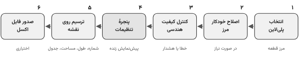 <b>شکل ۳.</b> مراحل کار دستور DAS از انتخاب پلی‌لاین تا صدور اکسل.

## ۴. دستورهای DAS و DASL

هر دو دستور یک کار می‌کنند. تنها فرقشان ستون طول اضلاع در جدول مختصات است: `DASL` این ستون را دارد و `DAS` ندارد. طول اضلاع روی خود نقشه در هر دو رسم می‌شود.

### ۱. انتخاب پلی‌لاین

پلی‌لاین سبک (LWPOLYLINE) یا پلی‌لاین قدیمی دوبعدی را انتخاب کنید. قطعه باید دست‌کم سه رأس مجزا داشته باشد. جهت رسم مهم نیست: DAS رئوس را همیشه در جهت عقربه‌های ساعت شماره می‌زند، چون برگهٔ گواهی «شماره ضلع گردش در جهت ساعت» می‌خواهد.

### ۲. اصلاح خودکار مرز

اگر مرز ایرادهای ساده‌ای داشته باشد که بشود بی‌خطر درستشان کرد، پیش از هر چیز پنجره‌ای باز می‌شود و فهرست آن‌ها را نشان می‌دهد:

رأس تکراری یا رأسی که کمتر از یک سانتی‌متر با رأس قبلی فاصله دارد حذف می‌شود. این حالت معمولاً از دو بار گرفتن یک نقطه یا Join کردن خط‌ها پیش می‌آید. اگر رأس آخر روی رأس اول باشد، رأس آخر حذف می‌شود. پلی‌لاین باز بسته می‌شود. ارتفاع (Z) غیرصفر هم صفر می‌شود، چون در گواهی فقط مختصات افقی می‌آید.

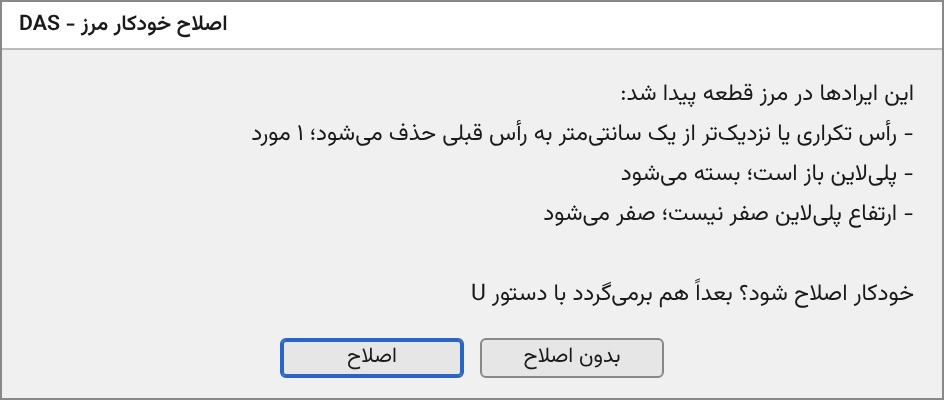 <b>شکل ۴.</b> پنجرهٔ اصلاح خودکار مرز. فقط ایرادهایی که در قطعه پیدا شده فهرست می‌شوند.

با «اصلاح»، خود پلی‌لاین تغییر می‌کند. اگر پشیمان شدید، با `U` برمی‌گردد. با «بدون اصلاح»، پلی‌لاین دست نمی‌خورد و ایرادها در مرحلهٔ بعد هشدار می‌گیرند. این اصلاح فقط روی پلی‌لاین سبک انجام می‌شود.

### ۳. کنترل کیفیت هندسی

DAS مرز را بررسی می‌کند و ایرادها را در دو دسته گزارش می‌دهد. جای هر ایراد با یک دایره در لایهٔ `L-QC` روی نقشه مشخص می‌شود. فهرست کامل در بخش «کنترل کیفیت» آمده است.

**خطا** یعنی مساحت یا شماره‌گذاری قابل اعتماد نیست، مثل مرزی که خودش را قطع کرده است. کار تا تأیید شما متوقف می‌ماند و پیشنهاد DAS این است که اول ایراد را اصلاح کنید.

**هشدار** مانع کار نیست و فقط برای اطلاع شماست، مثل ضلعی کوتاه‌تر از پنج سانتی‌متر.

### ۴. پنجرهٔ تنظیمات

همهٔ تنظیمات ترسیم، مجاورین و مشخصات متقاضی در یک پنجره است. بخش بعد تک‌تک خانه‌ها را توضیح می‌دهد.

### ۵. پیش‌نمایش و ترسیم

دکمهٔ «پیش نمایش زنده روی نقشه» خروجی را موقت رسم می‌کند. می‌توانید زوم و جابه‌جا کنید و با Enter به پنجره برگردید. هر بار که تنظیمی را عوض کنید، می‌توانید دوباره پیش‌نمایش بگیرید. پیش‌نمایش با بستن پنجره پاک می‌شود.

با OK خروجی نهایی رسم می‌شود. اگر این قطعه قبلاً با DAS خروجی گرفته باشد، خروجی قبلی‌اش خودکار پاک می‌شود و دو نسخه روی هم نمی‌افتد. اگر نام متقاضی و شمارهٔ ملی را نوشته باشید، DAS در آخر می‌پرسد گواهی و نقشه در اکسل صادر شود یا نه.

> **نکته:** همهٔ کار DAS یک گام Undo است. یک بار `U` کل خروجی، و اگر مرز اصلاح شده باشد اصلاح مرز را هم، برمی‌گرداند.

## ۵. پنجرهٔ تنظیمات

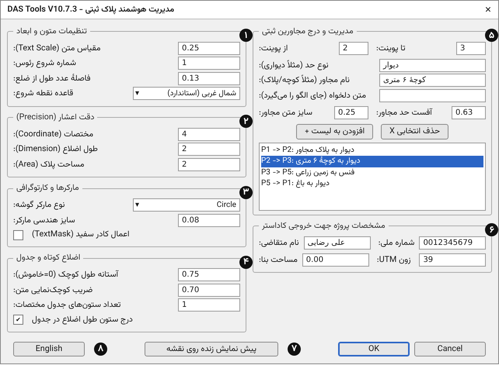 <b>شکل ۵.</b> پنجرهٔ تنظیمات DAS با مقادیر خودکار برای قطعهٔ نمونه. دکمهٔ ۸ پنجره را انگلیسی می‌کند.

شماره‌های روی شکل با بندهای زیر می‌خوانند.

### ۱. تنظیمات متون و ابعاد

**مقیاس متن** ارتفاع متن شمارهٔ رئوس، طول اضلاع و جدول است، به واحد نقشه (متر). بقیهٔ اندازه‌ها، مثل برچسب مساحت، ضریبی از همین عددند.

**شماره شروع رئوس** عدد اولین رأس است. معمولاً ۱ است، ولی اگر قطعه ادامهٔ نقشهٔ دیگری است، می‌توانید از عدد دیگری شروع کنید.

**فاصلهٔ عدد طول از ضلع** فاصلهٔ خالی بین ضلع و عدد طول آن است. عدد طول همیشه بیرون قطعه و موازی ضلع می‌نشیند.

**قاعده نقطه شروع** تعیین می‌کند رأس شمارهٔ ۱ کدام باشد. توضیح کامل در بخش «رأس شمارهٔ ۱» آمده است.

### ۲. دقت اعشار

تعداد رقم اعشار مختصات در جدول (پیش‌فرض ۴)، طول اضلاع (پیش‌فرض ۲) و مساحت (پیش‌فرض ۲).

### ۳. مارکرها و کارتوگرافی

**نوع مارکر گوشه** علامت روی هر رأس است: دایره، مربع، مثلث، ضربدر یا هیچ. **سایز هندسی مارکر** اندازهٔ آن است. با گزینهٔ **اعمال کادر سفید**، پشت متن‌های جدول یک کادر Wipeout می‌آید تا خط‌های زیرش متن را شلوغ نکنند.

### ۴. اضلاع کوتاه و جدول

عدد طول اضلاعی که از **آستانه طول کوچک** کوتاه‌ترند با **ضریب کوچک‌نمایی متن** کوچک‌تر نوشته می‌شود تا روی رأس‌ها نیفتد. صفر یعنی این قاعده خاموش است.

**تعداد ستون‌های جدول** برای قطعه‌های پررأس است. جدول طولانی به چند ستون کنار هم شکسته می‌شود. گزینهٔ **درج ستون طول اضلاع** با دستور DASL روشن و با DAS خاموش است.

### ۵. مجاورین

هر مجاور یک بازه از رئوس است. شمارهٔ رأس شروع و پایان، نوع حد و نام مجاور را بنویسید (یا به‌جای این دو، یک متن دلخواه) و «افزودن به لیست» را بزنید. توضیح کامل در بخش «مجاورین» آمده است.

### ۶. مشخصات پروژه

**نام متقاضی** و **شماره ملی** برای صدور اکسل لازم‌اند. اگر یکی خالی باشد، خروجی نقشه رسم می‌شود ولی اکسل ساخته نمی‌شود. شمارهٔ ملی با رقم کنترل بررسی می‌شود: کد ملی ده‌رقمی اشخاص حقیقی یا شناسهٔ ملی یازده‌رقمی اشخاص حقوقی. اگر رقم کنترل نخواند، DAS یک بار هشدار می‌دهد. اگر از درستی شماره مطمئنید، مثلاً برای اتباع خارجی، دوباره OK را بزنید. ارقام فارسی، فاصله و خط تیره خودکار پاک می‌شوند.

**مساحت بنا** فقط در فایل اکسل نوشته می‌شود. **زون UTM** (پیش‌فرض ۳۹) برای تبدیل مختصات وسط ملک به طول و عرض جغرافیایی در گواهی به کار می‌رود. زون غلط، طول و عرض غلط می‌دهد.

### ۷. پیش‌نمایش، OK و Cancel

Cancel پنجره را می‌بندد و چیزی رسم نمی‌کند.

### ۸. زبان پنجره

پنجره در هر بار باز کردن اتوکد به فارسی باز می‌شود. دکمهٔ English آن را به انگلیسی، و در نسخهٔ انگلیسی دکمهٔ «فارسی» آن را به فارسی برمی‌گرداند. هر چه تا آن لحظه نوشته‌اید، از جمله مجاورین، سر جایش می‌ماند. پیام‌های DAS هم از همان لحظه به زبان انتخابی نشان داده می‌شوند و تا بستن اتوکد همان زبان می‌ماند.

زبان پنجره فقط نوشته‌های پنجره و پیام‌های DAS را عوض می‌کند. جملهٔ مجاور همیشه فارسی ساخته می‌شود، حتی در پنجرهٔ انگلیسی: نوع حد «دیوار» و نام «کوچه» روی نقشه و در اکسل «دیواری است به کوچه» می‌شود. خط هر مجاور در فهرست پنجره هم در هر دو زبان همین‌طور است: «دیوار به کوچه».

اگر اتوکد قدیمی‌تر از ۲۰۲۱ باشد، یا زبان ویندوز برای برنامه‌های غیر Unicode فارسی نباشد، متن فارسی پنجره و پیام‌ها به شکل علامت سؤال دیده می‌شود. DAS این حالت را خودش تشخیص می‌دهد: پنجره انگلیسی باز می‌شود، دلیلش در خط فرمان نوشته می‌شود و دکمهٔ زبان غیرفعال می‌ماند. DASIMP در این حالت اجرا نمی‌شود، چون پیام‌هایش فقط فارسی است. در اتوکد قدیمی‌تر از ۲۰۲۱ جملهٔ مجاور هم ناچار فقط با یک خط تیره بین نوع حد و نام ساخته می‌شود، چون این نسخه‌ها متن فارسی را نگه نمی‌دارند. برای فارسی‌شدن، در ویندوز به Control Panel، بخش Region و زبانهٔ Administrative بروید، «Change system locale» را بزنید، Persian (Iran) را انتخاب کنید و رایانه را دوباره راه‌اندازی کنید. اتوکد قدیمی‌تر از ۲۰۲۱ متن فارسی این فایل را درست نمی‌خواند و با آن باید از پنجرهٔ انگلیسی استفاده کرد.

### اندازه‌های خودکار

وقتی قطعه‌ای را برای اولین بار باز می‌کنید، اندازه‌ها از روی ابعاد خود آن قطعه پر می‌شوند: ارتفاع متن حدود یک‌شصتم قطر کادر دور قطعه است و به یک عدد گرد مثل ۰٫۲۵ یا ۰٫۵ یا ۱ می‌رسد. بقیه ضریبی از آن‌اند. برای قطعهٔ نمونهٔ این راهنما با قطر حدود ۱۴٫۵ متر، ارتفاع متن ۰٫۲۵ می‌شود و برای قطعه‌ای ۱۰۰ متری حدود ۲٫۵.

هر چه در این پنجره تنظیم کنید روی خود پلی‌لاین ذخیره می‌شود: تنظیمات، متقاضی، شمارهٔ ملی و مجاورین. دفعهٔ بعد که DAS را روی همان قطعه اجرا کنید، همه برمی‌گردند. کپی یک قطعه این اطلاعات را با خود نمی‌برد و خالی شروع می‌شود، تا گواهی قطعهٔ دیگری به نام متقاضی قبلی صادر نشود.

## ۶. پنجرهٔ انگلیسی

همهٔ خانه‌های پنجره در نسخهٔ انگلیسی همان کار را می‌کنند. شکل زیر پنجره را بعد از زدن دکمهٔ English نشان می‌دهد و جدول بعد از آن، نام هر خانه را در دو زبان کنار هم می‌گذارد.

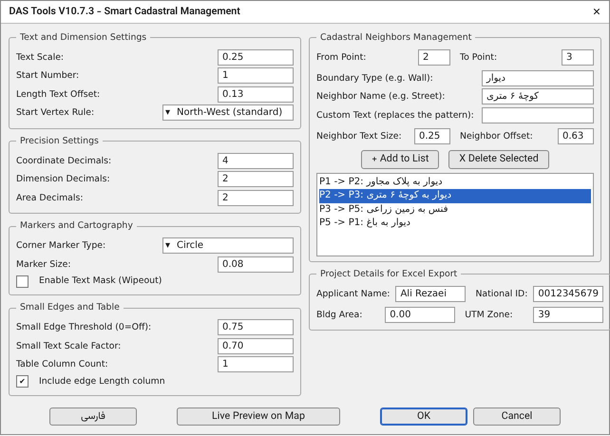 <b>شکل ۶.</b> همان پنجره بعد از زدن دکمهٔ English.

<table dir="rtl">
<thead><tr><th>بخش</th><th>فارسی</th><th>English</th></tr></thead>
<tr><td rowspan="4">۱</td><td>مقیاس متن</td><td dir="ltr">Text Scale</td></tr>
<tr><td>شماره شروع رئوس</td><td dir="ltr">Start Number</td></tr>
<tr><td>فاصلهٔ عدد طول از ضلع</td><td dir="ltr">Length Text Offset</td></tr>
<tr><td>قاعده نقطه شروع: شمال غربی، شمالی‌ترین، بدون تغییر</td><td dir="ltr">Start Vertex Rule: North-West, Northernmost, As drawn</td></tr>
<tr><td rowspan="3">۲</td><td>مختصات</td><td dir="ltr">Coordinate Decimals</td></tr>
<tr><td>طول اضلاع</td><td dir="ltr">Dimension Decimals</td></tr>
<tr><td>مساحت پلاک</td><td dir="ltr">Area Decimals</td></tr>
<tr><td rowspan="3">۳</td><td>نوع مارکر گوشه</td><td dir="ltr">Corner Marker Type</td></tr>
<tr><td>سایز هندسی مارکر</td><td dir="ltr">Marker Size</td></tr>
<tr><td>اعمال کادر سفید</td><td dir="ltr">Enable Text Mask (Wipeout)</td></tr>
<tr><td rowspan="4">۴</td><td>آستانه طول کوچک</td><td dir="ltr">Small Edge Threshold</td></tr>
<tr><td>ضریب کوچک‌نمایی متن</td><td dir="ltr">Small Text Scale Factor</td></tr>
<tr><td>تعداد ستون‌های جدول مختصات</td><td dir="ltr">Table Column Count</td></tr>
<tr><td>درج ستون طول اضلاع در جدول</td><td dir="ltr">Include edge Length column</td></tr>
<tr><td rowspan="9">۵</td><td>از پوینت / تا پوینت</td><td dir="ltr">From Point / To Point</td></tr>
<tr><td>نوع حد</td><td dir="ltr">Boundary Type</td></tr>
<tr><td>نام مجاور</td><td dir="ltr">Neighbor Name</td></tr>
<tr><td>متن دلخواه (جای الگو را می‌گیرد)</td><td dir="ltr">Custom Text (replaces the pattern)</td></tr>
<tr><td>سایز متن مجاور</td><td dir="ltr">Neighbor Text Size</td></tr>
<tr><td>آفست حد مجاور</td><td dir="ltr">Neighbor Offset</td></tr>
<tr><td>افزودن به لیست</td><td dir="ltr">Add to List</td></tr>
<tr><td>حذف انتخابی</td><td dir="ltr">Delete Selected</td></tr>
<tr><td>(عنوان بخش) مدیریت و درج مجاورین ثبتی</td><td dir="ltr">Cadastral Neighbors Management</td></tr>
<tr><td rowspan="4">۶</td><td>نام متقاضی</td><td dir="ltr">Applicant Name</td></tr>
<tr><td>شماره ملی</td><td dir="ltr">National ID</td></tr>
<tr><td>مساحت بنا</td><td dir="ltr">Bldg Area</td></tr>
<tr><td>زون UTM</td><td dir="ltr">UTM Zone</td></tr>
<tr><td>۷</td><td>پیش نمایش زنده روی نقشه</td><td dir="ltr">Live Preview on Map</td></tr>
<tr><td>۸</td><td>English / فارسی</td><td dir="ltr">فارسی / English</td></tr>
</table>

## ۷. رأس شمارهٔ ۱

DAS رئوس را همیشه در جهت عقربه‌های ساعت شماره می‌زند. قاعدهٔ نقطهٔ شروع فقط تعیین می‌کند شماره‌گذاری از کدام رأس شروع شود. سه گزینه دارد:

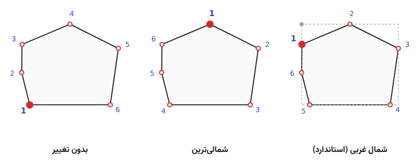 <b>شکل ۷.</b> رأس شمارهٔ ۱ در سه قاعده روی یک قطعه. شماره‌گذاری همیشه در جهت عقربه‌های ساعت است.

**شمال غربی (استاندارد)** رأسی است که به گوشهٔ شمال‌غربی کادر دور قطعه نزدیک‌تر است (نقطهٔ خاکستری در شکل). این همان «شمال غربی» شیوه‌نامه است و پیش‌فرض DAS است.

**شمالی‌ترین** رأسی است که بیشترین عرض (Y) را دارد. رفتار نسخه‌های قدیمی DAS همین بود.

**بدون تغییر** شماره‌گذاری را از اولین رأسی شروع می‌کند که پلی‌لاین با آن رسم شده است.

در قاعدهٔ شمال‌غربی، رأسی که روی یک ضلع صاف افتاده باشد و گوشهٔ واقعی نباشد (زاویهٔ داخلی بیشتر از ۱۷۵ درجه) هیچ‌وقت رأس شمارهٔ ۱ نمی‌شود. در برداشت با GPS این رأس‌ها زیادند. چنین رأسی شماره می‌گیرد و در جدول و اکسل هم می‌آید، فقط شمارهٔ ۱ نمی‌شود. در شکل بالا، رأس ۶ پانل اول چنین رأسی است.

## ۸. مجاورین

هر مجاور یک بازه از رئوس قطعه است، از یک رأس تا رأس دیگر در جهت عقربه‌های ساعت. یک بازه ممکن است یک ضلع باشد یا چند ضلع پشت سر هم.

برای هر مجاور این خانه‌ها را پر کنید:

**از پوینت** و **تا پوینت**: شمارهٔ رأس شروع و پایان بازه، همان شماره‌هایی که روی نقشه می‌آید.

**نوع حد**: جنس مرز، مثل «دیوار» یا «فنس». DAS خودش «ی است به» را اضافه می‌کند، پس «دیوار» نوشته می‌شود «دیواری است به ...».

**نام مجاور**: آنچه آن طرف حد است، مثل «کوچهٔ ۶ متری» یا «پلاک ۱۲۴ فرعی».

جملهٔ مجاور از کنار هم گذاشتن این دو ساخته می‌شود: **نوع حد + «ی است به» + نام مجاور**. مثلاً نوع «دیوار» و نام «کوچهٔ ۶ متری» می‌شود «دیواری است به کوچهٔ ۶ متری». همین جمله روی نقشه و در هر دو فایل اکسل می‌آید. زبان پنجره روی آن اثری ندارد: حتی اگر پنجره انگلیسی باشد، جملهٔ مجاور با همین الگوی فارسی ساخته می‌شود.

**متن دلخواه**: اگر این الگو برای حدی مناسب نیست، جملهٔ مجاور را خودتان در این خانه بنویسید، مثلاً «دیوار مشترک با پلاک ۱۲۴ فرعی». وقتی این خانه پر باشد، نوع حد و نام مجاور نادیده گرفته می‌شوند و DAS همان متن را عیناً می‌نویسد، بدون «ی است به» و بدون هیچ تغییری. این متن جای جملهٔ الگو را می‌گیرد: روی نقشه، در فهرست پنجره و در هر دو فایل اکسل. بعد از هر بار افزودن، این خانه خالی می‌شود و برای مجاور بعدی دوباره با الگو شروع می‌کنید.

بعد «افزودن به لیست» را بزنید. برای حذف یک مورد، آن را در فهرست انتخاب کنید و «حذف انتخابی» را بزنید.

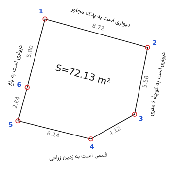 <b>شکل ۸.</b> چهار مجاور قطعهٔ نمونه: از ۱ تا ۲، از ۲ تا ۳، از ۳ تا ۵ و از ۵ تا ۱.

متن هر مجاور بیرون قطعه، موازی خط واصل دو سر بازه و بعد از عدد طول اضلاع می‌نشیند. اگر بازه فرورفتگی یا برآمدگی داشته باشد، فاصله آن‌قدر بیشتر می‌شود که متن روی رئوس نیفتد. اندازه و فاصلهٔ متن مجاور را با «سایز متن مجاور» و «آفست حد مجاور» تنظیم کنید.

در هر دو فایل اکسل، متن هر مجاور جلوی همهٔ اضلاع آن بازه نوشته می‌شود. اضلاعی که مجاوری برایشان ثبت نشده «---» می‌گیرند.

> **نکته:** نوع حدی که با «ه» یا «ی» تمام می‌شود، مثل «نرده»، با «ی است به» درست ترکیب نمی‌شود. برای این موارد کلمه‌ای مثل «فنس» بنویسید، یا جملهٔ کامل را در خانهٔ «متن دلخواه» بنویسید.

> **نکته:** اگر بعد از ثبت مجاورین تعداد رئوس قطعه عوض شود، شماره‌ها جابه‌جا می‌شوند و DAS مجاورین ذخیره‌شده را کنار می‌گذارد و خبر می‌دهد. آن‌ها را دوباره وارد کنید.

## ۹. خروجی روی نقشه

هر بخش خروجی روی لایهٔ جداگانه‌ای رسم می‌شود. لایه‌ها اگر وجود نداشته باشند ساخته می‌شوند و اگر خاموش، فریز یا قفل باشند، باز می‌شوند.

<table dir="rtl">
<tr><th>لایه</th><th>محتوا</th><th>رنگ</th></tr>
<tr><td><code dir="ltr">L-TEXT</code></td><td>شمارهٔ رئوس</td><td>آبی</td></tr>
<tr><td><code dir="ltr">L-POINTS</code></td><td>مارکر رئوس</td><td>قرمز</td></tr>
<tr><td><code dir="ltr">L-DIM</code></td><td>طول اضلاع</td><td>خاکستری</td></tr>
<tr><td><code dir="ltr">L-AREA</code></td><td>برچسب مساحت</td><td>سفید (در چاپ سیاه)</td></tr>
<tr><td><code dir="ltr">L-NEIGHBOR</code></td><td>متن مجاورین</td><td>سفید (در چاپ سیاه)</td></tr>
<tr><td><code dir="ltr">L-TABLE</code></td><td>جدول مختصات</td><td>سفید (در چاپ سیاه)</td></tr>
<tr><td><code dir="ltr">L-QC</code></td><td>دایرهٔ ایرادهای هندسی</td><td>قرمز</td></tr>
</table>

**طول اضلاع** از نوع Dimension است. DAS برای آن‌ها سبک ابعاد جداگانه‌ای به نام `DAS_LEN` می‌سازد که فلش، خط اندازه و خط رابط ندارد و فقط عدد را موازی ضلع می‌نویسد. سبک ابعاد جاری شما دست نمی‌خورد.

**برچسب مساحت** یک Field است که به خود پلی‌لاین وصل است. اگر رأسی را جابه‌جا کنید، عدد مساحت بعد از `REGEN` خودش به‌روز می‌شود. DAS برچسب را در عمیق‌ترین نقطهٔ داخل قطعه می‌گذارد و اندازه‌اش را طوری کم می‌کند که کامل داخل قطعه جا شود. پس‌زمینهٔ خاکستری پشت این عدد سایهٔ نمایش Field در اتوکد است و چاپ نمی‌شود. برای پنهان کردنش روی صفحه، `FIELDDISPLAY` را صفر کنید.

**جدول مختصات** زیر همهٔ خروجی، یعنی بعد از متن مجاورین، رسم می‌شود تا با آن‌ها تداخل نداشته باشد. ستون‌هایش شمارهٔ نقطه، شرقی (X)، شمالی (Y) و در DASL طول ضلع تا نقطهٔ بعد است.

همهٔ متن‌های لاتین با سبک متن `DAS_ROMANS` (فونت romans.shx) و متن مجاورین با `DAS_FARSI` (فونت Arial) نوشته می‌شوند.

## ۱۰. خروجی اکسل و گواهی

بعد از ترسیم، اگر نام متقاضی و شمارهٔ ملی پر باشد، DAS می‌پرسد گواهی و نقشه در اکسل صادر شود یا نه. با «بله» دو فایل ساخته می‌شود. اکسل در پس‌زمینه باز و بسته می‌شود و به فایل‌های اکسلی که خودتان باز کرده‌اید کاری ندارد.

### فایل گواهی: `Gvahi_Azla_<نام متقاضی>.xlsx`

از الگوی `temp1.xlsx` ساخته می‌شود و برگهٔ «گواهی تعیین مختصات ملک» است. طول و عرض جغرافیایی وسط ملک با هفت رقم اعشار، و برای هر ضلع در جهت عقربه‌های ساعت شمارهٔ ضلع، طول افقی و مجاور در آن نوشته می‌شود.

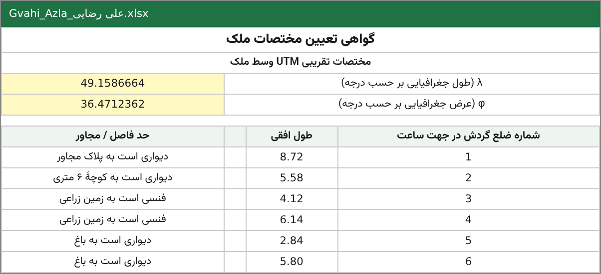 <b>شکل ۹.</b> برگهٔ گواهی تعیین مختصات ملک برای قطعهٔ نمونه (فایل Gvahi_Azla).

### فایل نقشه: `ParcelMap_<نام متقاضی>.xlsx`

از الگوی `temp2.xlsx` ساخته می‌شود و این‌ها را دارد: نام و شمارهٔ ملی متقاضی، مساحت ملک و بنا، زون و تعداد گوشه‌ها. بعد از آن، برای هر نقطه شماره، X، Y و مجاور. ستون طول با فرمول خود الگو از روی مختصات حساب می‌شود.

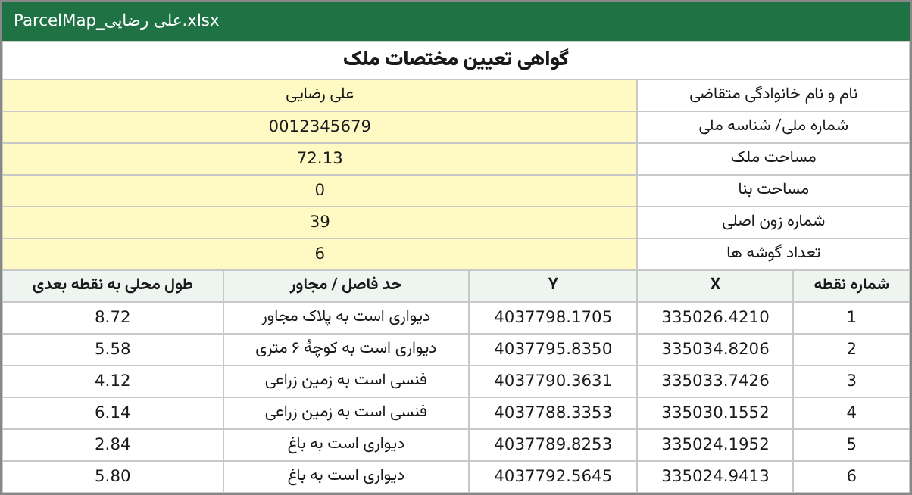 <b>شکل ۱۰.</b> فایل ParcelMap برای قطعهٔ نمونه.

### محل ذخیره و نام فایل

هر دو فایل کنار فایل نقشه (پوشهٔ همان DWG) ذخیره می‌شوند. اگر نقشه هنوز ذخیره نشده باشد، به پوشهٔ Documents می‌روند. نویسه‌هایی که در نام فایل مجاز نیستند از نام متقاضی حذف می‌شوند. اگر فایلی با همین نام از قبل باشد، DAS می‌پرسد: جایگزین شود، با نام تازه (مثل `_2`) ذخیره شود، یا لغو شود.

هر دو الگو ظرفیت مشخصی دارند (۱۶ و ۱۴ ردیف). برای قطعه‌های پررأس‌تر ردیف اضافه می‌شود و ردیف‌های خالیِ زیادی حذف می‌شوند.

### پیدا کردن الگوها

DAS الگوها را به این ترتیب جست‌وجو می‌کند: پوشه‌ای که بار قبل نشان داده‌اید، مسیرهای جست‌وجوی اتوکد، زیرپوشهٔ `templates` در همان مسیرها، و در آخر `C:\DAS_Templates`. اگر هیچ‌کدام نبود، یک بار محل `temp1.xlsx` را از شما می‌پرسد و آن پوشه را به خاطر می‌سپارد.

> **نکته:** در الگوها دست ببرید، ولی جای سلول‌ها را عوض نکنید. DAS شمارهٔ سلول‌ها را می‌شناسد، نه عنوانشان را.

## ۱۱. کنترل کیفیت

DAS پیش از باز کردن پنجرهٔ تنظیمات مرز را بررسی می‌کند. دستور `DASQC` همین بررسی را روی چند قطعه با هم و بدون ترسیم انجام می‌دهد: قطعه‌ها را انتخاب کنید تا گزارش هر کدام در یک پنجره بیاید و ایرادها در لایهٔ `L-QC` دایره بخورند.

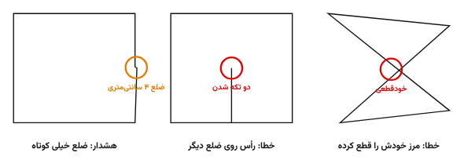 <b>شکل ۱۱.</b> نمونهٔ ایرادهای هندسی و دایره‌های لایهٔ L-QC.

<table dir="rtl">
<tr><th>نوع</th><th>ایراد</th><th>توضیح</th></tr>
<tr><td class="err">خطا</td><td>کمتر از سه رأس</td><td>پلی‌لاین قطعه نیست.</td></tr>
<tr><td class="err">خطا</td><td>ضلع قوسی</td><td>مساحت گواهی از مختصات رئوس حساب می‌شود و با شکل قوسی نمی‌خواند. قوس را با چند رأس بشکنید.</td></tr>
<tr><td class="err">خطا</td><td>خودقطعی</td><td>مرز خودش را قطع کرده است و مساحت معتبر نیست.</td></tr>
<tr><td class="err">خطا</td><td>تماس مرز با خودش</td><td>رأسی روی رأس یا ضلع دیگری (کمتر از یک سانتی‌متر) افتاده و قطعه دو تکه شده است.</td></tr>
<tr><td class="warn">هشدار</td><td>پلی‌لاین باز</td><td>DAS آن را بسته فرض می‌کند.</td></tr>
<tr><td class="warn">هشدار</td><td>ضلع کوتاه</td><td>ضلعی کوتاه‌تر از پنج سانتی‌متر.</td></tr>
<tr><td class="warn">هشدار</td><td>زاویهٔ تیز</td><td>زاویهٔ داخلی تیزتر از پنج درجه؛ معمولاً یک رأس اشتباه.</td></tr>
<tr><td class="warn">هشدار</td><td>ارتفاع غیرصفر</td><td>در گواهی فقط مختصات افقی می‌آید.</td></tr>
<tr><td class="warn">هشدار</td><td>قرینه یا چرخیده</td><td>پلی‌لاین با MIRROR یا در UCS چرخیده رسم شده است. DAS مختصات را به دستگاه جهانی برمی‌گرداند.</td></tr>
<tr><td class="warn">هشدار</td><td>بیرون از ایران</td><td>مختصات در محدودهٔ زون‌های UTM ایران نیست.</td></tr>
</table>

DAS خودقطعی و تماس را خودکار اصلاح نمی‌کند، چون نمی‌شود حدس زد کدام رأس جابه‌جا شده است. جای دایره را ببینید، رأس را اصلاح کنید و دوباره اجرا کنید.

## ۱۲. ویرایش قطعه بعد از خروجی

DAS در خروجی نهایی یک اثرانگشت روی پلی‌لاین می‌گذارد: تاریخ، تعداد رئوس، مساحت و مجموع مختصات. با این اثرانگشت می‌شود فهمید قطعه بعد از خروجی دست خورده است یا نه. جابه‌جا کردن قطعه هم تغییر حساب می‌شود.

### DASCHECK

قطعه‌ها را انتخاب کنید یا Enter بزنید تا همهٔ قطعه‌هایی که با DAS خروجی گرفته‌اند بررسی شوند. قطعه‌های تغییرکرده با دایرهٔ قرمز در لایهٔ `L-QC` علامت می‌خورند و تاریخ خروجی‌شان گزارش می‌شود.

### DASUPDATE

قطعه‌های ویرایش‌شده را بدون باز کردن پنجره، با همان تنظیمات و مجاورینی که روی هر قطعه ذخیره شده، دوباره رسم می‌کند. خروجی قبلی پاک و اثرانگشت تازه می‌شود. با Enter همهٔ قطعه‌های تغییرکردهٔ فضای جاری به‌روز می‌شوند.

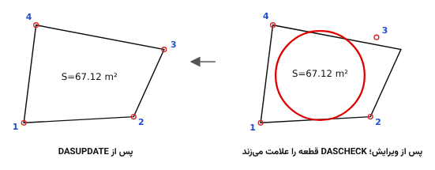 <b>شکل ۱۲.</b> رأس ۳ بعد از خروجی جابه‌جا شده است. مساحت خودش به‌روز شده، ولی بقیهٔ خروجی منتظر DASUPDATE است.

DASUPDATE فایل‌های اکسل را دوباره نمی‌سازد. اگر مختصات قطعه عوض شده است، برای گواهی تازه DAS را روی آن قطعه اجرا کنید. قطعه‌ای که خطای هندسی داشته باشد به‌روز نمی‌شود و فقط دایره می‌خورد. اگر تعداد رئوس عوض شده باشد، مجاورین آن قطعه کنار گذاشته می‌شوند.

## ۱۳. دستورهای دیگر

### DASXY: برچسب مختصات یک نقطه

روی هر نقطه‌ای کلیک کنید (۱) و بعد جای متن را نشان دهید (۲). یک لیدر با مختصات X و Y آن نقطه در لایهٔ `L-LEADER` رسم می‌شود. دقت اعشار همان دقت مختصات پنجرهٔ DAS است. تا Esc نزنید، دستور برای نقطه‌های بعدی ادامه دارد.

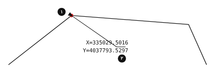 <b>شکل ۱۳.</b> نقطهٔ کلیک‌شده (۱) و جای متن (۲) در دستور DASXY.

### DASRESET

همهٔ تنظیمات این جلسهٔ اتوکد را به پیش‌فرض برمی‌گرداند: اندازه‌ها، دقت‌ها، زبان، قاعدهٔ شروع، نام متقاضی و زون. اطلاعاتی که روی خود قطعه‌ها ذخیره شده دست نمی‌خورد.

## ۱۴. پرسش‌های رایج

### متن‌ها خیلی بزرگ یا خیلی کوچک‌اند.

اگر قطعه تنظیمات ذخیره‌شده دارد، همان‌ها می‌آیند. مقیاس متن را در پنجره عوض کنید و پیش‌نمایش بگیرید. بقیهٔ اندازه‌ها را هم متناسب تنظیم کنید یا مقدار مناسب را یک بار پیدا کنید؛ از آن به بعد روی همان قطعه ذخیره می‌ماند.

### پیام «فایل‌های الگوی اکسل پیدا نشدند».

پوشهٔ `templates` را کنار فایل لیسپ بگذارید و آن پوشه را به Support File Search Path اضافه کنید، یا وقتی DAS پرسید، `temp1.xlsx` را نشان دهید.

### اکسل ساخته نمی‌شود.

نام متقاضی و شمارهٔ ملی هر دو لازم‌اند و Microsoft Excel باید روی همان رایانه نصب باشد. اگر یکی از این‌ها نباشد، DAS پیامش را در پایان کار نشان می‌دهد.

### طول و عرض جغرافیایی گواهی درست نیست.

زون UTM را در پنجره بررسی کنید. پیش‌فرض ۳۹ است. قزوین و تهران در زون ۳۹ هستند، ولی برای مثال غرب کشور در زون ۳۸ است.

### بعد از کشیدن رأس، شمارهٔ رئوس و جدول جابه‌جا نشدند.

فقط برچسب مساحت زنده است و خودش به‌روز می‌شود. `DASUPDATE` را بزنید تا شمارهٔ رئوس، طول اضلاع، مجاورین و جدول هم دوباره رسم شوند.

### دو خروجی روی هم افتاده است.

از نسخهٔ 10.5 به بعد، اجرای دوبارهٔ DAS خروجی قبلی همان قطعه را پاک می‌کند. خروجی نسخه‌های قدیمی‌تر این علامت را ندارد و باید یک بار با دست پاک شود.

## ۱۵. فهرست دستورها

<table dir="rtl">
<tr><th>دستور</th><th>کار</th></tr>
<tr><td><code dir="ltr">DAS</code></td><td>ترسیم شمارهٔ رئوس، طول اضلاع، مجاورین، مساحت و جدول مختصات؛ صدور اکسل</td></tr>
<tr><td><code dir="ltr">DASL</code></td><td>مثل DAS، با ستون طول اضلاع در جدول</td></tr>
<tr><td><code dir="ltr">DASUPDATE</code></td><td>بازترسیم قطعه‌های ویرایش‌شده با تنظیمات ذخیره‌شده</td></tr>
<tr><td><code dir="ltr">DASQC</code></td><td>کنترل هندسی چند قطعه با هم، بدون ترسیم</td></tr>
<tr><td><code dir="ltr">DASCHECK</code></td><td>پیدا کردن قطعه‌هایی که بعد از خروجی تغییر کرده‌اند</td></tr>
<tr><td><code dir="ltr">DASXY</code></td><td>برچسب مختصات یک نقطه با لیدر</td></tr>
<tr><td><code dir="ltr">DASRESET</code></td><td>بازگرداندن تنظیمات جلسه به پیش‌فرض</td></tr>
</table>

## ۱۶. حمایت از DAS Tools

DAS Tools رایگان است و رایگان می‌ماند. نسخه‌های تازه، رفع ایرادها و همین راهنما در وقت آزاد ساخته می‌شوند. اگر DAS کارتان را سریع‌تر کرده و خواستید از ادامهٔ توسعه‌اش حمایت کنید، صفحهٔ حمایت این‌جاست:

 

`hamibash.com/dastools`

کد را با دوربین گوشی اسکن کنید یا نشانی را در مرورگر باز کنید. پرداخت از درگاه بانکی انجام می‌شود و ثبت‌نام لازم ندارد.

DAS Tools، ساختهٔ سیدمهدی هاشمی، قزوین. رایگان برای نقشه‌برداران، با مجوز MIT.

